  <picture><source media="(prefers-color-scheme: dark)" srcset="profile/header-dark.svg"></picture>

  <a href="https://www.linkedin.com/in/shivam91s/"><picture><source media="(prefers-color-scheme: dark)" srcset="profile/linkedin-dark.svg"></picture></a>&nbsp;&nbsp;<a href="https://x.com/Shivam_Terra"><picture><source media="(prefers-color-scheme: dark)" srcset="profile/x-dark.svg"></picture></a>&nbsp;&nbsp;<a href="https://terra01.dev"><picture><source media="(prefers-color-scheme: dark)" srcset="profile/portfolio-dark.svg"></picture></a>

### Things I've made

 
 

### What I build with

  <picture><source media="(prefers-color-scheme: dark)" srcset="profile/toolkit-dark.svg"></picture>

